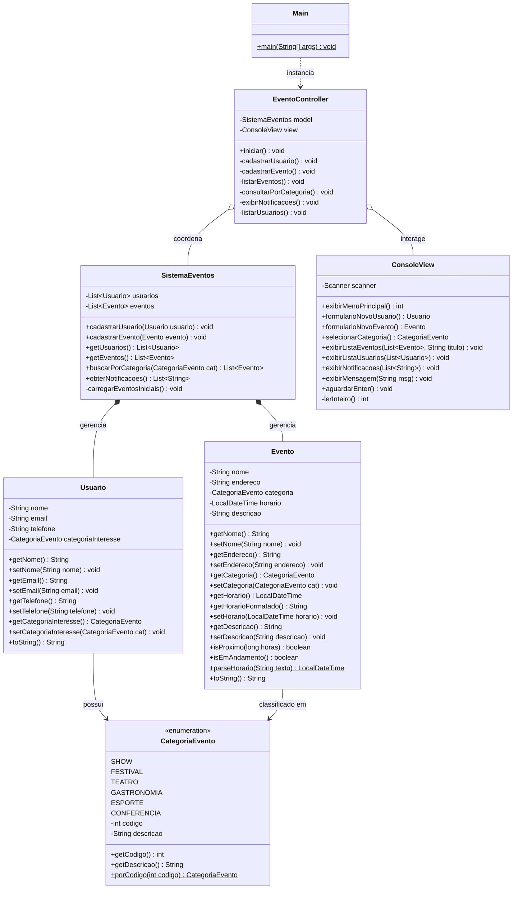

# Diagrama de Classes UML — Sistema de Eventos

Abaixo encontra-se a modelagem estrutural das classes do sistema, demonstrando as relações de associação, agregação e dependência dentro do padrão arquitetural **MVC**.

---

---

### Descrição dos Relacionamentos

1. **`Usuario` e `CategoriaEvento`**: O usuário possui uma referência à sua categoria preferida para direcionamento de avisos.
2. **`Evento` e `CategoriaEvento`**: Cada evento obrigatoriamente pertence a uma das categorias delimitadas.
3. **`SistemaEventos`**: Atua como o núcleo da camada **Model**, gerenciando listas em memória de `Usuario` e `Evento`.
4. **`EventoController`**: Coordena o fluxo da aplicação; recebe eventos da `ConsoleView` e manipula as regras de negócio em `SistemaEventos`.
5. **`ConsoleView`**: Isola todas as saídas no terminal e entradas do teclado via `Scanner`.
6. **`Main`**: Ponto de entrada do programa, responsável pela injeção das dependências do padrão MVC.
